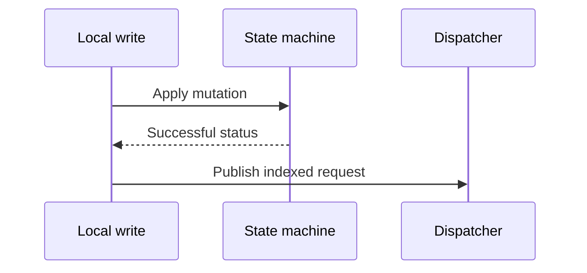

import Embed from '../../components/Embed.astro';

## Local writes and outbound progress

IoTConsensus V1 first applies a write through a local state machine. After success, the local index progresses and the request is offered to outbound dispatch. Each destination owns its own synchronization progress. See [the local write path](https://github.com/apache/iotdb/blob/dc790cca0aac847f678aaa4214fc7ac2ba1a6bf5/iotdb-core/consensus/src/main/java/org/apache/iotdb/consensus/iot/IoTConsensusServerImpl.java#L346-L376).

## Keep the snapshot suffix

Consider a snapshot ending at index $s = 100$. The replacement needs the suffix $i > s$ through its catch-up frontier. An already computed WAL cleanup cutoff can be unsafe once a peer has enrolled. [PR #19268](https://github.com/apache/iotdb/pull/19268) publishes retention during enrollment, coordinates eligibility and deletion with bound changes, and stops outbound dispatch at unexpected gaps.

<Embed id="wal-rebuild-after" />

## Verify the boundary

The [region reconstruction integration test](https://github.com/apache/iotdb/blob/3f841b00f3b9bc41e92c0445596c44075b6598b5/integration-test/src/test/java/org/apache/iotdb/confignode/it/regionmigration/pass/commit/IoTDBRegionReconstructWALIT.java) is part of the merged change. The gallery scene uses illustrative index values.

